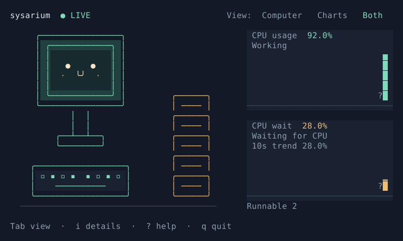

# Sysarium

A live Linux CPU monitor with a friendly computer, clear numbers, and short histories.

```sh
cargo install --path apps/sysarium --locked
sysarium
# Or: cargo run --release -p sysarium
```

Requires Linux, Rust 1.88+, and a UTF-8 terminal of at least **80 × 24**. SSH with a PTY works too. `sysarium live` opens the same monitor.



This preview uses synthetic fixtures, not a real load experiment.

| Control | Action |
|---|---|
| `Tab` / `1` · `2` · `3` | Switch view: Computer / Charts / Both |
| `i` / `?` | Details / help |
| `Esc` | Back |
| `↑↓` / `PgUp` / `PgDn` / `Home` | Scroll |
| `q` / `Ctrl-C` | Quit |

**Both** shows the computer and charts together. Smaller terminals show a resize prompt and live values. Resizing back restores the full view; monitoring continues throughout.

| Metric | Meaning |
|---|---|
| CPU usage · Working | CPU time spent doing work, across all CPUs (approx.). |
| CPU wait · Waiting for CPU | Time with at least one task waiting for CPU, measured by Linux PSI some. |
| 10s trend | Smoothed CPU wait over roughly 10 seconds. |
| Runnable | Running and ready tasks; not a waiting count. |

High usage can come with little waiting or with heavy contention. The keyboard follows usage; stacked papers reflect waiting, not a task count.

Details define **PSI** (Pressure Stall Information) and the **window** (time between the last two readings). Formulas and counters stay in JSON. Usage keeps the existing definition: user + nice + system + irq + softirq, divided by the first eight CPU time counters; I/O wait and steal are excluded from work. It may differ from other monitors. See [architecture](docs/ARCHITECTURE.md).

Updates run at ~1 Hz, animation at up to 10 FPS. Charts keep up to 120 readings, past on the left, latest on the right, on a 0–100% scale. `N/A` and `?` mean unknown; `▁` marks zero or very low values. The first reading needs about one second for a difference. Missing data never becomes zero.

```sh
sysarium --json > observations.ndjson
# Ctrl-C to stop
```

One JSON record is flushed per reading, including the first. Schema v1 retains units, sample IDs, raw counters, formulas, and complete failure reasons. Diagnostics go to stderr. Closing a pipe exits cleanly. Only the visible `/proc` scope is observed; container and VM scope may differ from the physical host.

```sh
cargo fmt --all -- --check
cargo test --workspace --locked
cargo clippy --workspace --all-targets --locked -- -D warnings
python3 apps/sysarium/tests/verify_terminal.py
cargo build --release --locked -p sysarium
```

The workspace has three crates: OS-independent `inside-core`, procfs I/O in `inside-linux`, and the `sysarium` app. Tests use fixtures and PTYs; no automated high-load workload is started. Manual load comparison and user evaluation remain open. See [validation](docs/P3-VALIDATION.md), [decisions](docs/DECISIONS.md), and [release checks](docs/RELEASE.md).

The app was renamed from `inside` before release. Install and run `sysarium`; internal library names remain unchanged. GUI, Agent, Simulation, and long-term storage are outside v0.1.
